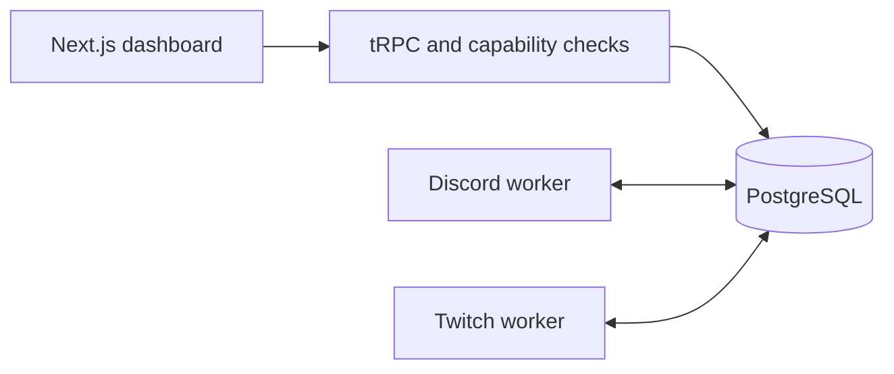

# Shared features

Community Bot runs one creator workspace. Features are built-in TypeScript modules shipped with the application. It does not download or execute uploaded plugins.

## Where code belongs

| Location | Responsibility |
| --- | --- |
| `packages/core` | Client-safe feature catalog, configuration validators, commands, capability rules, reward templates |
| `packages/db` | Durable configuration, identity proofs, encrypted credentials, atomic redemption claims |
| `packages/twitch` | Server-only creator authorization and Twitch API access |
| `packages/api` | Validated dashboard operations and server-side permission checks |
| `apps/twitch`, `apps/discord` | SDK connections, event adapters, delivery, retries, health |
| `apps/web` | Configure the same feature definitions and display their state |

Both adapters call the shared command handler. Commands do not contain SDK calls: an adapter supplies a stream lookup and receives response text. The dashboard feature catalog reads the same definitions. The public Twitch command page reads the shared command list.

## Add a feature

1. Add its metadata and strict configuration schema in `packages/core/src/features.ts`.
2. Select its supported platforms and required capability. Choose the smallest scope.
3. Store configuration with a platform-qualified ID such as `twitch.uptime`. A Twitch setting must not change Discord behavior.
4. Add a validated server operation when the feature changes data. Check capabilities again in that operation.
5. Keep provider SDK work in the corresponding adapter. Reuse shared business logic for both platforms.
6. Add a focused test for the behavior and a browser journey if it introduces a dashboard flow.

Changing a role's permission does not grant the bot new native permissions. Twitch scopes, Discord server permissions, the signed-in person's mapped role, and the feature switch must all allow the action.

## Communication between apps

The dashboard calls tRPC in `apps/web`. Validated operations update PostgreSQL. Each bot reads desired settings every five seconds and writes a heartbeat. The browser never receives bot credentials or calls a worker control port. Workers start and stop independently.

For a future feature such as announcing a Twitch redemption in Discord, add a durable action row containing its event ID, destination, validated payload, state, and result. The destination worker must atomically claim the row, check the feature and destination permissions again, and record delivery. Reusing the redemption claim pattern avoids calling one bot directly from the other. This general cross-platform action table is a future extension, not an implemented message bridge.

PostgreSQL `LISTEN`/`NOTIFY` can later wake a worker sooner. Keep the action in a table and retain periodic recovery reads: notifications alone are not durable jobs. No Redis or extra message broker is needed for this single-creator workload. [PostgreSQL notification documentation](https://www.postgresql.org/docs/17/sql-notify.html)

gRPC remains an option for separately deployed services in other languages. This all-TypeScript app already shares contracts through tRPC and workspace packages. Browser gRPC uses a separate web transport; the official quickstart also configures a proxy. Adding that transport has no current feature benefit here. [gRPC-Web quickstart](https://grpc.io/docs/platforms/web/quickstart/)

## Channel Point actions

The creator enables rewards, then reauthorizes their Twitch account. The bot account keeps its chat scopes. Rewards need an eligible Affiliate or Partner creator and `channel:manage:redemptions`.

Only rewards created by this Twitch application can be edited or fulfilled through it. Other rewards are read-only. Moderators can handle the queue; admins can configure rewards. The creator controls authorization.

Supported chat placeholders are `{user}`, `{input}`, and `{reward}`. Values expand once into one line, capped at 500 characters. No scripts or expressions execute.

Incoming events are saved with a unique redemption ID. One worker claims an automatic response before sending. A confirmed send can optionally fulfill the reward. A failed or uncertain send is left for manual review and is never retried automatically. After downtime, the worker reads outstanding redemptions for managed rewards; completed events from downtime cannot be replayed through EventSub.

Leaving or muting chat pauses automatic chat replies. Reward events can still be collected independently. Refund and fulfillment are explicit actions in the queue. Run one replica of each bot worker; a distributed lease is required before horizontal scaling.
